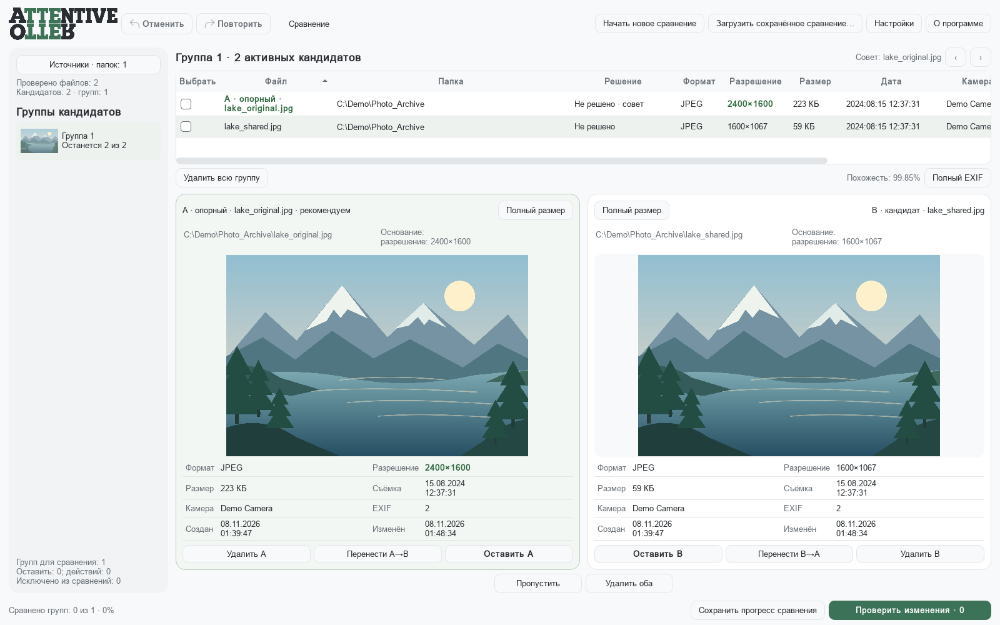

# Attentive Otter

Desktop photo comparison for **Windows and macOS**, with native beta packages for Windows x64, Apple Silicon and Intel Macs.

[Русское описание](README_RU.md) · [Windows beta](https://github.com/AlexSmart1982/attentive-otter/releases/tag/v1.0.0-beta.1) · [macOS beta](https://github.com/AlexSmart1982/attentive-otter/releases/tag/v1.0.0-beta.2) · [License and distribution](docs/LICENSING.md)

Attentive Otter finds duplicate and visually similar images by their content, including rotated, resized and recompressed copies. It groups candidates for side-by-side review so you can decide which versions to keep and how to organize your archive. Images are processed locally.

The screenshot uses an original synthetic landscape and demonstration paths. No personal photographs are included.

## Downloads and platform status

| Platform | Status | Package |
| --- | --- | --- |
| Windows x64 | 1.0 BETA | [Portable ZIP](https://github.com/AlexSmart1982/attentive-otter/releases/download/v1.0.0-beta.1/Attentive_Otter_1.0_BETA_Windows_x64.zip) |
| macOS Apple Silicon | 1.0 BETA 2; macOS 14+ | [arm64 ZIP](https://github.com/AlexSmart1982/attentive-otter/releases/download/v1.0.0-beta.2/Attentive_Otter_1.0_BETA_2_macOS_arm64.zip) |
| macOS Intel | 1.0 BETA 2; macOS 14+ | [x64 ZIP](https://github.com/AlexSmart1982/attentive-otter/releases/download/v1.0.0-beta.2/Attentive_Otter_1.0_BETA_2_macOS_x64.zip) |
| Corresponding Source | Available for this Windows build | [Complete source ZIP](https://github.com/AlexSmart1982/attentive-otter/releases/download/v1.0.0-beta.1/Attentive_Otter_1.0_BETA_Corresponding_Source.zip) |

The Windows release includes [SHA256 checksums](https://github.com/AlexSmart1982/attentive-otter/releases/download/v1.0.0-beta.1/SHA256SUMS.txt). macOS checksums and matching source packages for each architecture are in [beta.2](https://github.com/AlexSmart1982/attentive-otter/releases/tag/v1.0.0-beta.2). Complete source packages include dependency sources and notices. GitHub's automatic **Source code** archives contain the repository, not the full dependency-source bundle.

## Start on Windows

1. Download and extract the entire Windows ZIP.
2. Open `Attentive-Otter-1.0-BETA-Windows-x64` and run `Attentive_Otter.exe`. Keep `_internal` beside it. Python installation is not required.
3. Add image folders and start a comparison.
4. Review groups and make decisions. Save progress to resume later.
5. Open the change plan and apply it when ready.

Applying the plan performs real file operations. Undo and redo manage review decisions before application; they do not reverse an already completed batch.

This is a beta release. The executable is not digitally signed. The current interface is in Russian.

## Start on macOS

Extract the archive for your Mac, copy `Attentive_Otter.app` to Applications, and open it. Python is included. Builds require macOS 14+ and are tested on macOS 15. They are ad-hoc signed without Apple notarization. See [first launch instructions and macOS file-locking limits](docs/MACOS.md).

## What it does

- Reads JPEG, PNG and HEIC images and compares their visual content, accounting for rotation.
- Caches image features in SQLite and uses an indexed candidate search followed by a detailed comparison.
- Shows previews, image properties and EXIF, with configurable recommendations and their reasons.
- Supports individual keep/delete decisions, group review, undo/redo and saved comparisons.
- Sends discarded files to the native system Trash or a selected folder. Supports moves and replacements with collision checks.
- Verifies source hashes before applying actions and uses a transaction journal for recovery after interrupted application.

The internal similarity score is a comparison metric, not a measured probability that two photographs are identical. [Known limitations](docs/KNOWN_LIMITATIONS.md) include date interpretation and dense groups.

## Project and implementation

The application is used to review a real archive of **84,000+ images and 5,365 candidate groups**. The released source snapshot passed **174 automated tests** and executable checks covering image formats, saved progress, file operations and relocation to a new path. See [release provenance](docs/RELEASE_PROVENANCE.md).

The original comparison algorithm and product concept are by **Скрябин Александр**. Parameter tuning and UI design were refined jointly with an AI assistant. AI assistants were also used for code implementation, tests, refactoring, performance diagnostics, packaging and documentation. Product requirements, priorities and acceptance testing were directed by the author.

Technology: Python, PyQt5, OpenCV, NumPy, SciPy, SQLite and PyInstaller. See [build instructions](docs/BUILDING.md), [contributing](CONTRIBUTING.md) and the [macOS roadmap](docs/ROADMAP.md).

## License and contact

Original application code: **GNU GPL version 3 only**, `GPL-3.0-only`. Personal and commercial use are allowed. Redistribution and modifications are subject to the GPL; third-party components retain their licenses. See [LICENSE](LICENSE), [COPYRIGHT.txt](COPYRIGHT.txt) and [distribution requirements](docs/LICENSING.md).

Author: **Скрябин Александр** · [alexsmart@yandex.ru](mailto:alexsmart@yandex.ru)

For bugs, use [Issues](https://github.com/AlexSmart1982/attentive-otter/issues). For a possible security or data-integrity issue, see [SECURITY.md](SECURITY.md).
