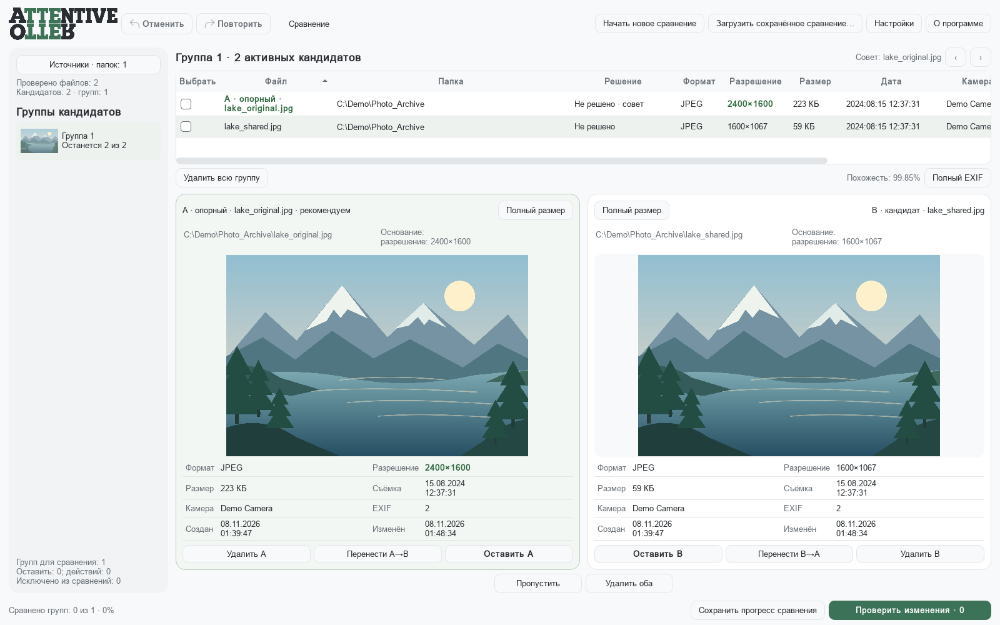

# Attentive Otter

Приложение для поиска дубликатов и похожих изображений по содержимому. Целевые платформы — **Windows и macOS**. Сейчас доступна **Windows x64 beta**; версия macOS запланирована, готовая сборка ещё не опубликована.

[English](README.md) · [Скачать Windows beta](https://github.com/AlexSmart1982/attentive-otter/releases/tag/v1.0.0-beta.1) · [Лицензия и распространение](docs/LICENSING.md)

На иллюстрации используются синтетический пейзаж и демонстрационные пути. Пользовательских фотографий в репозитории нет.

## Возможности

- Поиск похожих JPEG, PNG и HEIC, включая повёрнутые, уменьшенные и повторно сжатые копии.
- Кеширование признаков и ускоренный отбор кандидатов с последующей подробной проверкой.
- Попарный просмотр фотографий, метаданные и EXIF, настраиваемые рекомендации с объяснением.
- Решения по отдельным файлам и группам, отмена и повтор решений, сохранение места остановки.
- Удаление в корзину Windows или выбранную папку, перемещения и замены с проверкой коллизий.
- Проверка SHA256 перед применением и журнал восстановления прерванной операции.

Обработка выполняется локально. Для поиска не требуется отправлять фотографии на сервер.

## Скачать и запустить

1. Откройте [релиз 1.0 BETA](https://github.com/AlexSmart1982/attentive-otter/releases/tag/v1.0.0-beta.1).
2. Скачайте `Attentive_Otter_1.0_BETA_Windows_x64.zip` и распакуйте целиком.
3. В папке `Attentive-Otter-1.0-BETA-Windows-x64` запустите `Attentive_Otter.exe`. Папка `_internal` должна оставаться рядом; устанавливать Python не нужно.
4. Добавьте папки с изображениями, выполните поиск и разберите найденные группы.
5. Сохраните прогресс, чтобы вернуться к той же паре позже. Перед реальными действиями откройте план изменений.

«Применить изменения» выполняет настоящие файловые операции. «Отменить» и «Повторить» относятся к решениям до применения, а не к откату уже выполненного batch.

На кнопке сохранения сначала появляется «Сохраняю…», затем «Сохранено» и время. Первое сохранение предлагает выбрать файл, повторное записывает прогресс в тот же JSON. Текущая beta-сборка не имеет цифровой подписи.

## Платформы

| Платформа | Состояние |
| --- | --- |
| Windows x64 | Готовая переносимая beta-сборка |
| macOS | Запланирован порт и отдельная проверенная сборка |

См. [план macOS](docs/ROADMAP.md). Наличие Python/PyQt на macOS само по себе не подтверждает работу текущих файловых операций на этой платформе.

## Проверки и ограничения

Приложение используется для разбора реального архива из **84 000+ изображений и 5 365 групп кандидатов**. Снимок исходников этой сборки прошёл **174 автоматических теста**, проверки готового EXE и его переноса в другой путь. Это не оценка точности всех рекомендаций на всём архиве.

Шкала похожести — внутренняя метрика сравнения. Даты файлов Windows не определяют истинную дату съёмки. Подробнее — [известные ограничения](docs/KNOWN_LIMITATIONS.md) и [сведения о сборке](docs/RELEASE_PROVENANCE.md).

## Авторство и ИИ

**Алгоритм сравнения и идея продукта — авторство Скрябина Александра.** Сценарии, требования, выбор решений, приоритеты и приёмка на реальном архиве определялись автором.

Настройка параметров алгоритма и проработка UI выполнялись совместно с ИИ-ассистентом. ИИ также использовался для реализации и доработки кода, автоматических тестов, рефакторинга, диагностики производительности, сборки и документации.

[Описание проекта для портфолио](docs/PROJECT_RU.md).

## Лицензия и исходники

Собственный код приложения — **GNU GPLv3, только версия 3**, `GPL-3.0-only`. Разрешено личное и коммерческое использование. Изменение и распространение — на условиях GPL; сторонние библиотеки сохраняют свои лицензии.

Рядом с Windows ZIP размещён `Attentive_Otter_1.0_BETA_Corresponding_Source.zip`: точные исходники приложения, скрипты сборки, исходники зависимостей, лицензии и проверочные отчёты. Автоматический архив GitHub **Source code** не содержит полного набора исходных архивов зависимостей.

[Условия распространения](docs/LICENSING.md) · [LICENSE](LICENSE) · [COPYRIGHT.txt](COPYRIGHT.txt) · [Сборка](docs/BUILDING.md).

Автор: **Скрябин Александр**, [alexsmart@yandex.ru](mailto:alexsmart@yandex.ru). Ошибки и предложения: [Issues](https://github.com/AlexSmart1982/attentive-otter/issues).
